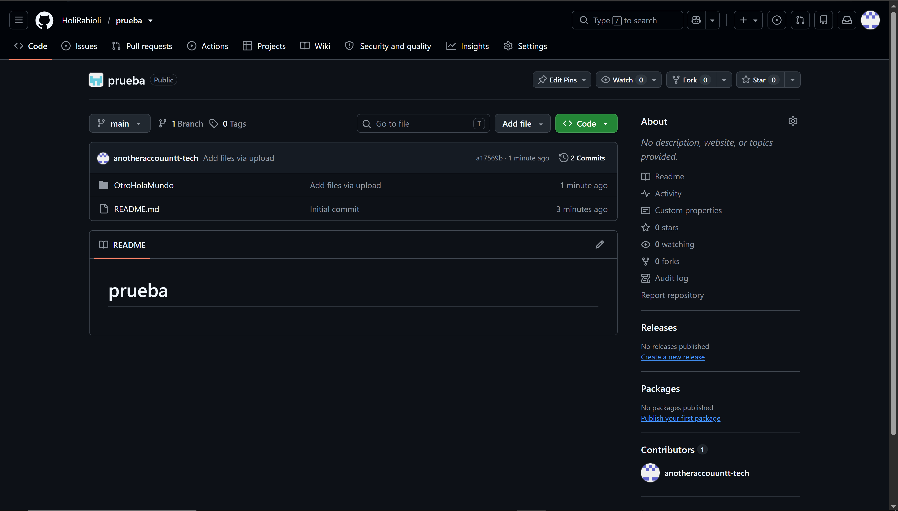
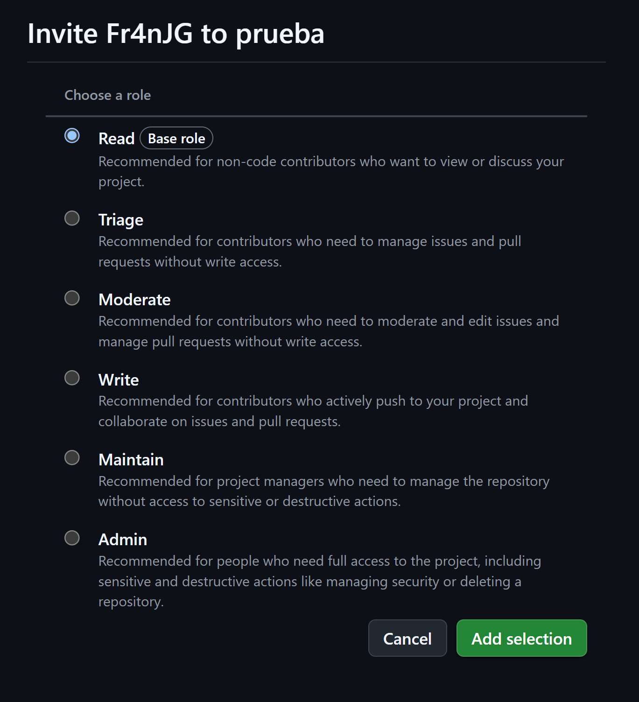
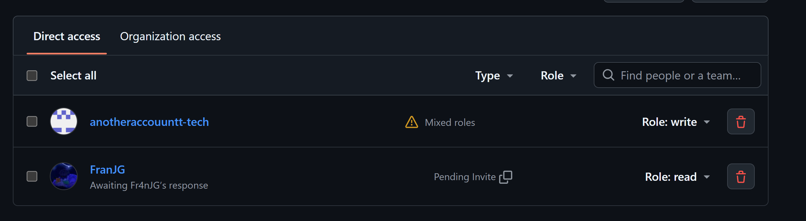
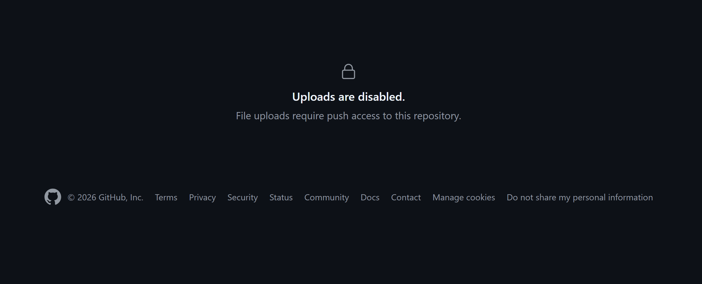
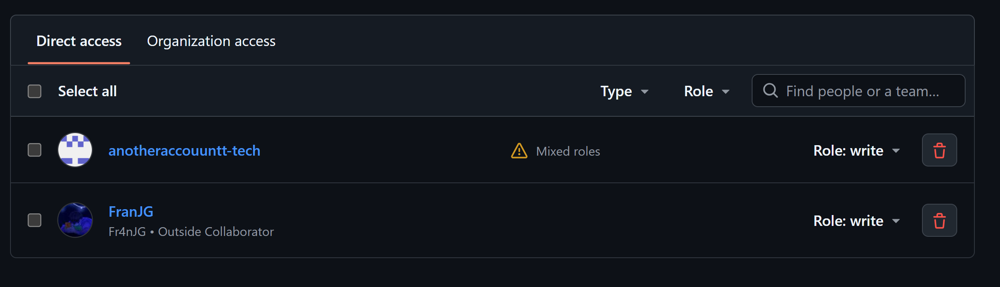
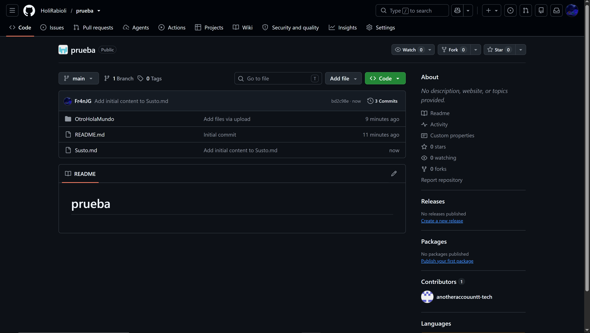
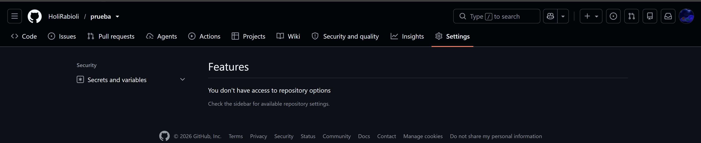
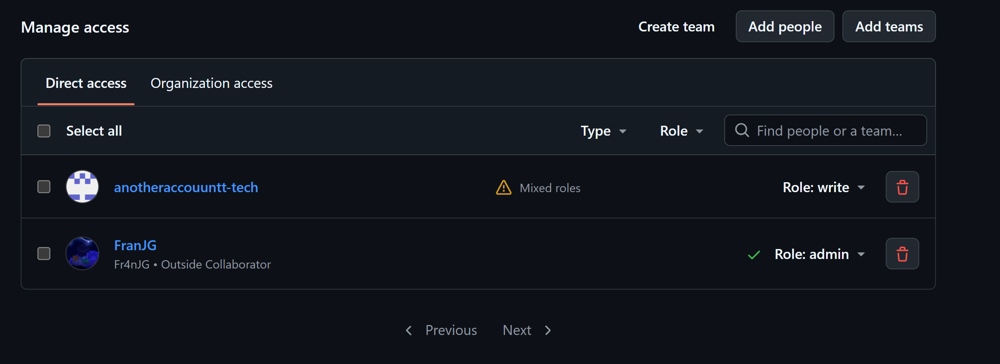
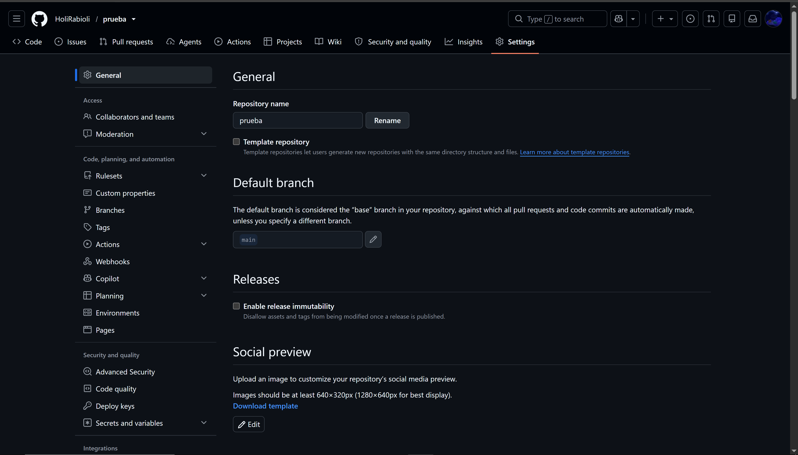

#  Configuración y pruebas de acceso

Repositorio: [https://github.com/HoliRabioli/prueba/tree/main](https://github.com/HoliRabioli/prueba/tree/main)

## 1. Creación del repositorio

Se creó el repositorio.

 

## 2. Invitación al colaborador

Se invitó al compañero desde **Settings → Collaborators and teams → Add people**.
 

## 3. Prueba con permiso de lectura (Read)

El colaborador tiene el rol **Read**. Puede ver el código y comentar, pero no puede modificar el repositorio.

Vista del colaborador con rol de lectura:
 

El colaborador no puede acceder a **Settings**:
 

## 4. Prueba con permiso de escritura (Write)

Se cambió el rol del colaborador a **Write**.

Rol del colaborador como escritor:
 

El colaborador añade un archivo al repositorio:
 

El colaborador sigue sin poder entrar en **Settings**:
 

## 5. Prueba con permiso de administrador (Admin)

Se cambió el rol del colaborador a **Admin**.

Rol del colaborador como administrador:
 

El colaborador ya puede entrar en **Settings**:

 

