# Instalación Ubuntu:
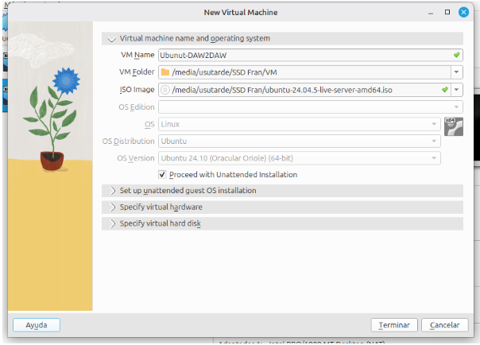     
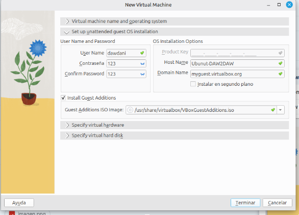   
En vez dawdani fran y la contraseña 1234   
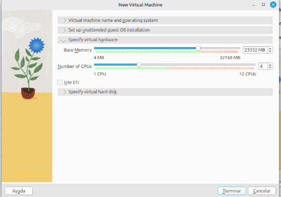   
En vez de 23MB 8 MB   
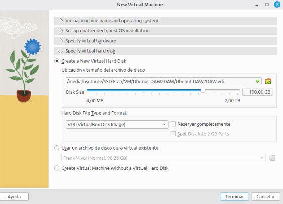   
# Instalación docker
## Imágenes:
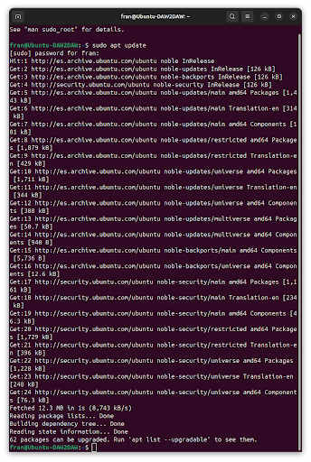    
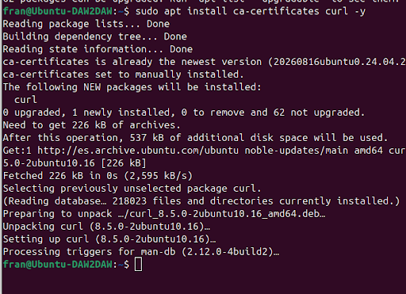    
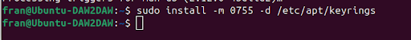    
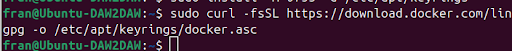     
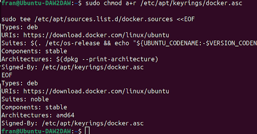    
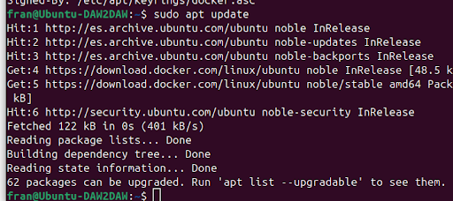   
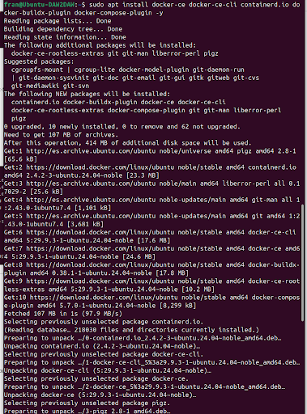   
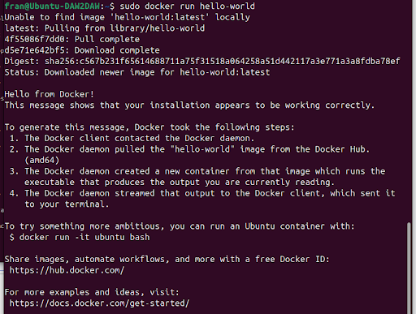    
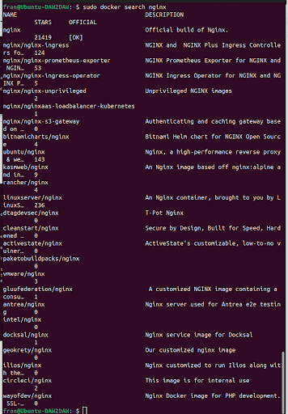    
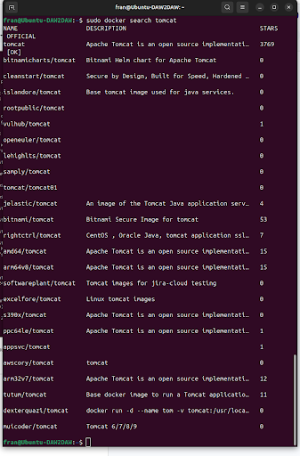    
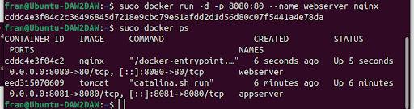   
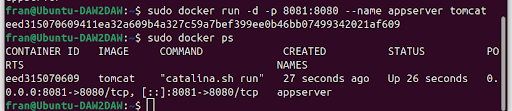   
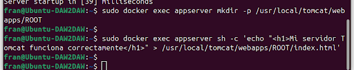    
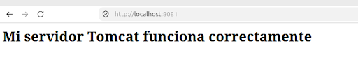   
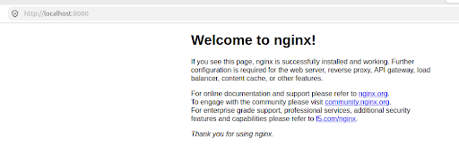   
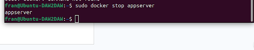    
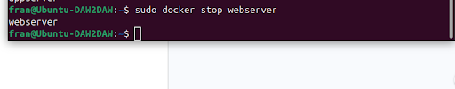   

## Comandos usados:
1.sudo apt update          
2.sudo apt install ca-certificates curl -y                            
3.sudo install -m 0755 -d /etc/apt/keyrings                        
4.sudo curl -fsSL https://download.docker.com/linux/ubuntu/gpg -o /etc/apt/keyrings/docker.asc                       
                      

5.sudo chmod a+r /etc/apt/keyrings/docker.asc                        
                                         
sudo tee /etc/apt/sources.list.d/docker.sources <<EOF     
Types: deb           
URIs: https://download.docker.com/linux/ubuntu        
Suites: (./etc/os-release&&echo"{UBUNTU_CODENAME:-$VERSION_CODENAME}")      
Components: stable      
Architectures: $(dpkg --print-architecture)    
Signed-By: /etc/apt/keyrings/docker.asc    
EOF    

6.sudo apt update            
7.sudo apt install docker-ce docker-ce-cli containerd.io docker-buildx-plugin docker-compose-plugin -y       
8.sudo docker run hello-world      
9.sudo docker search nginx       
10.sudo docker search tomcat       
11.sudo docker run -d -p 8080:80 --name webserver nginx       
12.sudo docker run -d -p 8081:8080 --name appserver tomcat        
13.sudo docker ps         
14.sudo docker exec appserver mkdir -p /usr/local/tomcat/webapps/ROOT      
15. `sudo docker exec appserver sh -c 'echo "<h1>Mi servidor Tomcat funciona correctamente</h1>" > /usr/local/tomcat/webapps/ROOT/index.html'`          
16.sudo docker stop appserver   
17.sudo docker stop webserver    

# Requerimientos mínimos para implantar una aplicación web:
* ## Requisitos de hardware y software 
    * **Procesador(CPU)** Se requiere un mínimo de 2 núcleos virtuales (vCPU) con arquitectura de 64 bits. 
    * **Memoria RAM** Se necesitan al menos 2 GB a 4 GB de memoria RAM. 
    * **Almacenamiento** Al menos 20 GB a 40 GB. 
    * **Sistema operativo** Se recomienda una distribución Linux de soporte extendido (LTS) como Ubuntu Server, Debian o AlmaLinux. 
    * **Entorno de ejecución y base de datos** Es necesario instalar el intérprete o compilador específico del lenguaje de programación (como Node.js, Python, PHP o Java) junto con un sistema gestor de bases de datos (como PostgreSQL, MySQL o MongoDB).

* ## Infraestructura de red
    * **Dirección IP pública y estática** El servidor debe contar con una dirección IP fija accesible desde internet.
    * **Nombre de dominio y DNS** Se requiere registrar un nombre de dominio y configurar sus registros DNS (como los registros tipo A o CNAME). 
    * **Ancho de banda y latencia** Se necesita una conexión de red estable con un ancho de banda simétrico mínimo de 100 Mbps.
    * **Apertura de puertos** La red debe permitir el tráfico entrante hacia los puertos estándar de navegación web. Los puertos principales son el 80 para tráfico HTTP y el 443 para tráfico seguro HTTPS.

* ## Configuración del servidor web y de aplicaciones
    * **Servidor web y proxy inverso** Se debe configurar un software como Nginx o Apache para recibir las peticiones de los clientes.
    * **Servidor de aplicaciones** Es necesario configurar un gestor de procesos o servidor interno (como Gunicorn, PM2 o Tomcat) que ejecute el código fuente. 
    * **Variables de entorno** Los datos sensibles y parámetros de configuración (como claves de API, credenciales de base de datos y modo de producción) deben almacenarse en variables de entorno externas al código fuente. 
    * **Gestión de registros (Logs)** Se debe habilitar la escritura de archivos de registro tanto para los accesos como para los errores del servidor. 

* ## Seguridad y mantenimiento
    * **Certificado SSL/TLS** Es obligatorio instalar un certificado digital (como los emitidos por Let's Encrypt) para habilitar el protocolo HTTPS. 
    * **Cortafuegos (Firewall)** Se debe activar un firewall a nivel de sistema operativo (como UFW o iptables) o de red. 
    * **Acceso administrativo seguro** El acceso remoto al servidor mediante SSH debe configurarse utilizando claves criptográficas en lugar de contraseñas simples.
    * **Copias de seguridad (Backups)** Se requiere programar respaldos automáticos y periódicos tanto de la base de datos como de los archivos subidos por los usuarios. 
    * **Actualizaciones y monitoreo** Es necesario aplicar de forma regular los parches de seguridad del sistema operativo y de las dependencias del software. 

