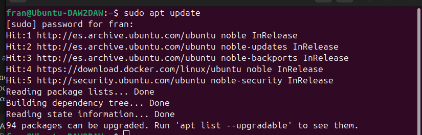
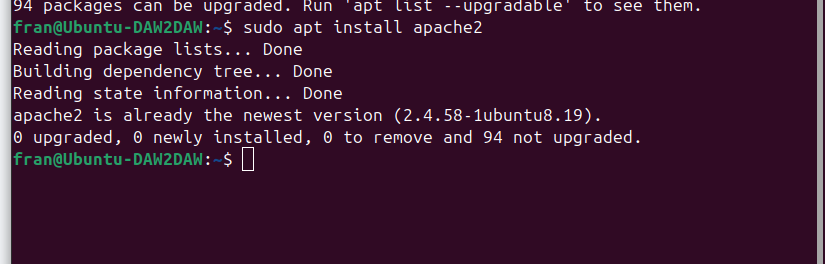
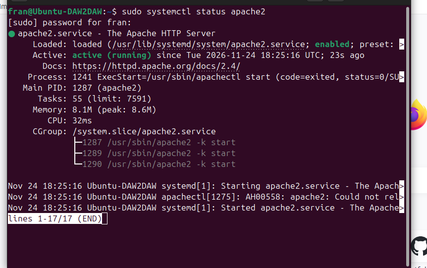
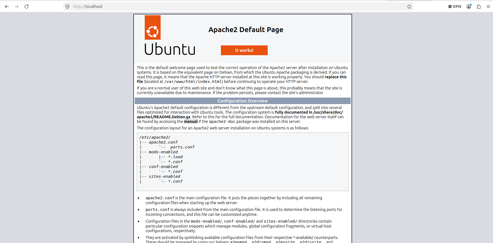
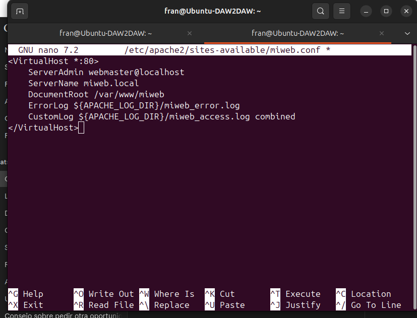
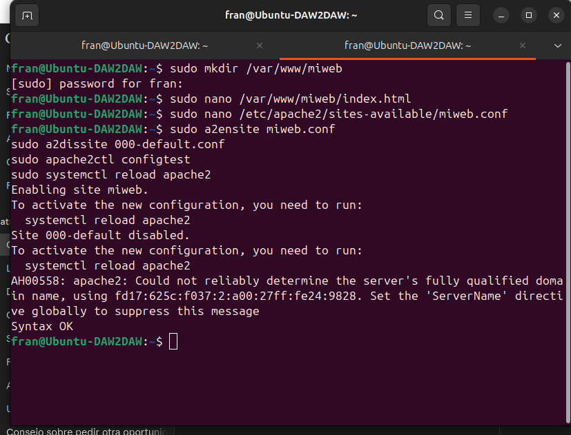
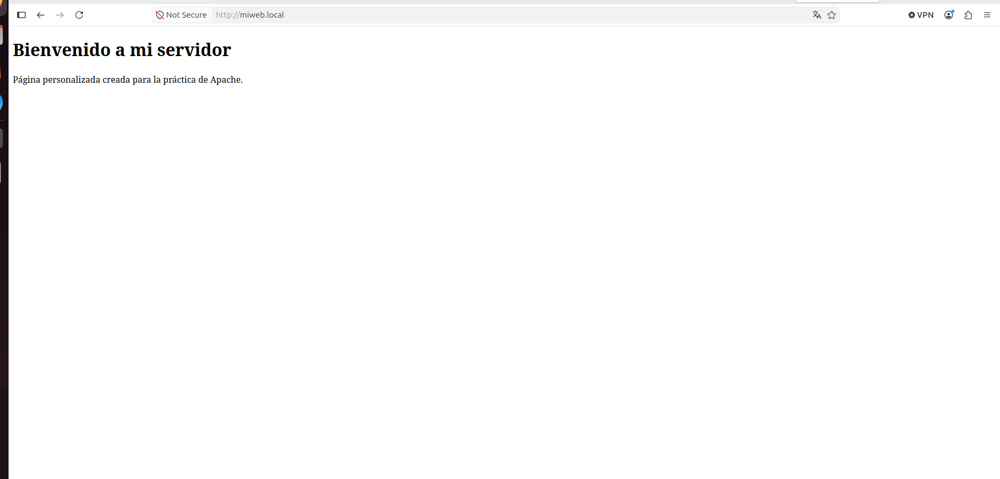
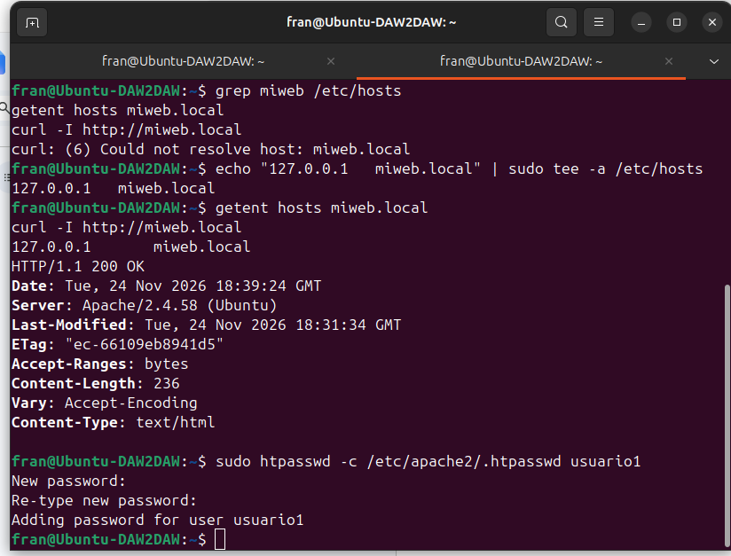

# Instalación y configuración de un servidor web
 

 
## Resumen
 
Se crea una página web personalizada, se configura un VirtualHost propio y se activa el sitio. Como ampliación, se implementa control de acceso mediante autenticación básica y restricción por IP. Por último, se exponen los resultados, los problemas encontrados y una valoración personal del trabajo.
 
## Palabras clave
 
Apache, servidor web, Ubuntu, VirtualHost, control de acceso, autenticación básica, htpasswd, seguridad.
 
## Índice
 
1. Introducción
2. Relación de las actividades realizadas
3. Presentación y valoración de resultados
4. Conclusión


## 1. Introducción
 
### 1.1 Contexto
 
Apache HTTP Server es un servidor web de código abierto, mantenido por la Apache Software Foundation. Su función es recibir peticiones HTTP/HTTPS de los clientes (navegadores) y devolver páginas, ficheros o resultados de aplicaciones. Nació en 1995 a partir del servidor NCSA HTTPd, y su nombre procede de «a patchy server» (un servidor «parcheado»). Durante décadas ha sido uno de los servidores web más utilizados del mundo. [Contrastar y ampliar con las fuentes consultadas.]
 
### 1.2 Alternativas
 
- Nginx
- LiteSpeed
- Microsoft IIS
- Caddy
### 1.3 Motivación
 
El objetivo es aprender a montar un servidor web funcional, servir un sitio propio y protegerlo con control de acceso, de modo que se comprendan los elementos básicos de la administración de un servidor.
 
## 2. Relación de las actividades realizadas
 
### 2.1 Instalación de Apache
 
```bash
sudo apt update
```
  
```bash
sudo apt install apache2
```
  
```bash
sudo systemctl status apache2
```
  

  

 
### 2.2 Paso 3: creación de una página web personalizada
 
```bash
sudo mkdir /var/www/miweb
sudo nano /var/www/miweb/index.html
```
 
```html
<!DOCTYPE html>
<html lang="es">
<head>
  <meta charset="UTF-8">
  <title>Mi servidor Apache</title>
</head>
<body>
  <h1>Bienvenido a mi servidor</h1>
  <p>Página personalizada creada para la práctica de Apache.</p>
</body>
</html>
```
 
 
### 2.3 Paso 4: configuración del VirtualHost
 
```bash
sudo nano /etc/apache2/sites-available/miweb.conf
```
 
```apache
<VirtualHost *:80>
    ServerAdmin webmaster@localhost
    ServerName miweb.local
    DocumentRoot /var/www/miweb
    ErrorLog ${APACHE_LOG_DIR}/miweb_error.log
    CustomLog ${APACHE_LOG_DIR}/miweb_access.log combined
</VirtualHost>
```
 
  
 
### 2.4 Paso 5: activación del sitio
 
```bash
sudo a2ensite miweb.conf
sudo a2dissite 000-default.conf
sudo apache2ctl configtest
sudo systemctl reload apache2
```

 
  
 
### 2.5 Tutorial adicional: control de acceso
 
Se busca en Google un tutorial sobre control de acceso en Apache [indicar URL en la bibliografía] y se aplican dos mecanismos.
 
**Autenticación básica con usuario y contraseña**
 
```bash
sudo htpasswd -c /etc/apache2/.htpasswd usuario1
```
 
Dentro del `<VirtualHost>`:
 
```apache
<Directory /var/www/miweb>
    AuthType Basic
    AuthName "Zona restringida"
    AuthUserFile /etc/apache2/.htpasswd
    Require valid-user
</Directory>
```
 
**Restricción por dirección IP** (alternativa a la anterior):
 
```apache
<Directory /var/www/miweb>
    Require ip 192.168.1.0/24
</Directory>
```
 
```bash
sudo systemctl reload apache2
```
 
  
  

 
### 2.6 Problemas surgidos
Error al conectar al puerto 80.    
Error al ejecutar incios de sesion.
 
## 3. Presentación y valoración de resultados
 
Se ha conseguido instalar Apache, publicar un sitio personalizado mediante un VirtualHost propio y protegerlo con control de acceso.
 
 
 
## 4. Conclusión
 
La práctica ha permitido comprender el proceso completo de puesta en marcha de un servidor web: instalación, publicación de contenido, configuración de sitios virtuales y protección del acceso.
 
